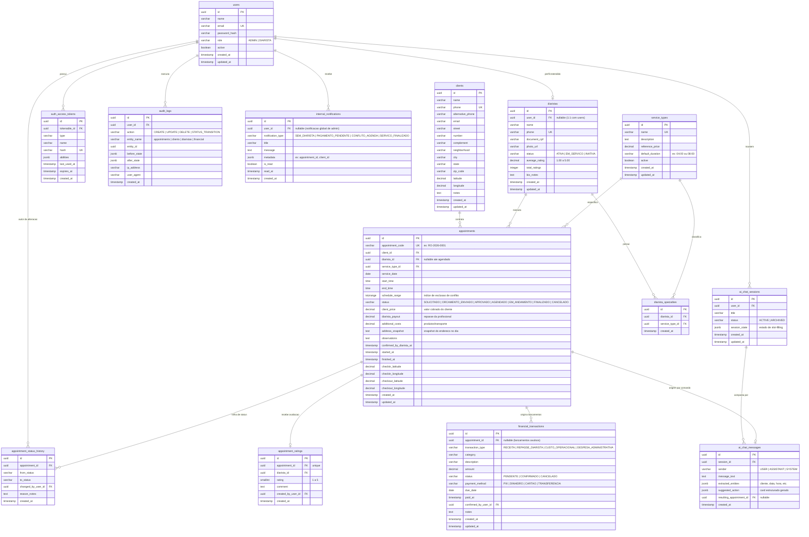

# Modelagem de Banco de Dados: Organiza+

* **SGBD:** PostgreSQL (v14+)
* **ORM:** Lucid ORM (AdonisJS v6)
* **Padrão de Nomenclatura:** `snake_case` para tabelas e colunas, singular para modelos AdonisJS (`User`), plural para tabelas (`users`), chave primária padrão `id` (UUIDv7 ou BigSerial, recomendado UUID para integridade distribuída e offline-ready).

---

## 1. Visão Geral e Diagrama Entidade-Relacionamento (ERD)

O modelo foi projetado para cobrir todas as necessidades de negócio da **RO Organização de Casas e Espaços**:
* **Atores & Segurança:** Usuários com RBAC (`ADMIN`, `DIARISTA`), perfis estendidos e tokens de API.
* **Cadastros Base:** Clientes (com endereços geocodificados) e Diaristas (com especialidades N:N e avaliações agregadas).
* **Catálogo & Precificação:** Tipos de serviço e regras de preço de referência.
* **Operação de Agendamento:** Máquina de estados estrita (`SOLICITADO` ➔ `FINALIZADO`), atribuição de diaristas, histórico de auditoria por etapa e prevenção de sobreposição de horários via PostgreSQL Range e exclusion constraints.
* **Execução em Campo Mobile:** Registro de início (`EM_ANDAMENTO`) e término (`FINALIZADO`), confirmação da escala e geolocalização do ponto de início/término.
* **Avaliação de Qualidade:** Notas 1 a 5 estrelas e comentários qualitativos por atendimento.
* **Financeiro & Conciliação:** Lançamentos de receitas, custos operacionais, repasses a diaristas, controle de despesas avulsas e rastreio de pagamentos pendentes.
* **Assistente de IA & Chat Operacional:** Sessões de chat da administradora, histórico de mensagens, extração estruturada de entidades JSONB e controle de *slot-filling*.
* **Notificações & Auditoria do Sistema:** Alertas internos e log de eventos administrativos.

### Diagrama Mermaid



---

## 2. Dicionário de Dados e Especificação das Tabelas

### 2.1. Tabela: `users`
Usuários do sistema com acesso via autenticação (Administradoras e Diaristas).

| Coluna | Tipo | Nulo? | Chave | Descrição / Restrições |
| :--- | :--- | :--- | :--- | :--- |
| `id` | `UUID` | Não | PK | Identificador único (`gen_random_uuid()`). |
| `name` | `VARCHAR(150)` | Não | | Nome completo do usuário. |
| `email` | `VARCHAR(150)` | Não | UK | E-mail corporativo / login único. |
| `password_hash` | `VARCHAR(255)` | Não | | Hash da senha (Argon2 / Bcrypt). |
| `role` | `VARCHAR(20)` | Não | | Papel no sistema: `'ADMIN'` ou `'DIARISTA'`. |
| `active` | `BOOLEAN` | Não | | Status ativo/inativo (default: `true`). |
| `created_at` | `TIMESTAMPTZ` | Não | | Data/hora de criação. |
| `updated_at` | `TIMESTAMPTZ` | Não | | Data/hora de última atualização. |

---

### 2.2. Tabela: `auth_access_tokens`
Tokens de acesso API Bearer (padrão oficial AdonisJS Auth Guard).

| Coluna | Tipo | Nulo? | Chave | Descrição / Restrições |
| :--- | :--- | :--- | :--- | :--- |
| `id` | `UUID` | Não | PK | Identificador do token. |
| `tokenable_id` | `UUID` | Não | FK | Referência para `users(id)` ON DELETE CASCADE. |
| `type` | `VARCHAR(50)` | Não | | Tipo do token (ex: `'api_token'`). |
| `name` | `VARCHAR(100)` | Não | | Nome do dispositivo ou sessão (ex: `'Expo Mobile Diarista'`). |
| `hash` | `VARCHAR(255)` | Não | UK | Hash do token em repouso. |
| `abilities` | `JSONB` | Sim | | Permissões granulares concedidas. |
| `last_used_at`| `TIMESTAMPTZ` | Sim | | Último uso do token. |
| `expires_at` | `TIMESTAMPTZ` | Sim | | Data de expiração (se configurada). |
| `created_at` | `TIMESTAMPTZ` | Não | | Data de emissão. |

---

### 2.3. Tabela: `clients`
Cadastro de clientes da RO Organização de Casas e Espaços ([RF02]).

| Coluna | Tipo | Nulo? | Chave | Descrição / Restrições |
| :--- | :--- | :--- | :--- | :--- |
| `id` | `UUID` | Não | PK | Identificador único. |
| `name` | `VARCHAR(150)` | Não | | Nome completo do cliente ou responsável. |
| `phone` | `VARCHAR(20)` | Não | UK | Telefone celular único com DDD (somente dígitos). |
| `alternative_phone` | `VARCHAR(20)` | Sim | | Telefone fixo ou contato secundário. |
| `email` | `VARCHAR(150)` | Sim | | E-mail para envio de propostas e recibos. |
| `street` | `VARCHAR(150)` | Não | | Logradouro / Rua / Avenida. |
| `number` | `VARCHAR(20)` | Não | | Número do imóvel. |
| `complement` | `VARCHAR(80)` | Sim | | Apartamento, bloco, casa 2, etc. |
| `neighborhood`| `VARCHAR(100)` | Não | | Bairro. |
| `city` | `VARCHAR(100)` | Não | | Cidade (default: sede da RO). |
| `state` | `VARCHAR(2)` | Não | | UF (ex.: `'SP'`). |
| `zip_code` | `VARCHAR(10)` | Sim | | CEP formatado. |
| `latitude` | `DECIMAL(10,8)`| Sim | | Coordenada geográfica para visualização em mapa. |
| `longitude` | `DECIMAL(11,8)`| Sim | | Coordenada geográfica para visualização em mapa. |
| `notes` | `TEXT` | Sim | | Orientações de acesso, portaria, animais, etc. |
| `created_at` | `TIMESTAMPTZ` | Não | | Data/hora de cadastro. |
| `updated_at` | `TIMESTAMPTZ` | Não | | Data/hora de atualização. |

---

### 2.4. Tabela: `diaristas`
Perfil das profissionais diaristas e colaboradoras de campo ([RF03, RF04]).

| Coluna | Tipo | Nulo? | Chave | Descrição / Restrições |
| :--- | :--- | :--- | :--- | :--- |
| `id` | `UUID` | Não | PK | Identificador único. |
| `user_id` | `UUID` | Sim | FK | Vínculo 1:1 opcional com `users(id)` para acesso ao App. |
| `name` | `VARCHAR(150)` | Não | | Nome completo da diarista. |
| `phone` | `VARCHAR(20)` | Não | UK | WhatsApp/celular com DDD. |
| `document_cpf`| `VARCHAR(14)` | Sim | UK | CPF para formalização e pagamentos. |
| `photo_url` | `VARCHAR(255)` | Sim | | URL da foto de perfil. |
| `status` | `VARCHAR(20)` | Não | | `'ATIVA'`, `'EM_SERVICO'`, `'INATIVA'`. |
| `average_rating`| `DECIMAL(3,2)`| Não | | Média histórica das avaliações (default: `5.00`). |
| `total_ratings`| `INTEGER` | Não | | Total de atendimentos avaliados (default: `0`). |
| `bio_notes` | `TEXT` | Sim | | Observações internas sobre perfil e preferências. |
| `created_at` | `TIMESTAMPTZ` | Não | | Data de inclusão. |
| `updated_at` | `TIMESTAMPTZ` | Não | | Data de alteração. |

---

### 2.5. Tabela: `service_types`
Catálogo dos tipos de serviços ofertados pela empresa ([RF05]).

| Coluna | Tipo | Nulo? | Chave | Descrição / Restrições |
| :--- | :--- | :--- | :--- | :--- |
| `id` | `UUID` | Não | PK | Identificador único. |
| `name` | `VARCHAR(100)` | Não | UK | Nome do serviço (ex.: *"Limpeza Residencial"*). |
| `description` | `TEXT` | Sim | | Descrição do escopo do serviço. |
| `reference_price`| `DECIMAL(10,2)`| Não| | Valor sugerido/base de tabela. |
| `default_duration`| `INTERVAL` | Não | | Duração estimada padrão (ex.: `'04:00:00'`, `'08:00:00'`). |
| `active` | `BOOLEAN` | Não | | Ativo no catálogo (default: `true`). |
| `created_at` | `TIMESTAMPTZ` | Não | | Data de criação. |
| `updated_at` | `TIMESTAMPTZ` | Não | | Data de alteração. |

---

### 2.6. Tabela: `diarista_specialties`
Tabela associativa que relaciona as diaristas aos serviços que executam (N:N).

| Coluna | Tipo | Nulo? | Chave | Descrição / Restrições |
| :--- | :--- | :--- | :--- | :--- |
| `id` | `UUID` | Não | PK | Identificador único. |
| `diarista_id` | `UUID` | Não | FK | Referência para `diaristas(id)` ON DELETE CASCADE. |
| `service_type_id`| `UUID` | Não | FK | Referência para `service_types(id)` ON DELETE CASCADE. |
| `created_at` | `TIMESTAMPTZ` | Não | | Data do vínculo. |

* **Constraint:** `UNIQUE (diarista_id, service_type_id)`.

---

### 2.7. Tabela: `appointments`
Tabela central do sistema: ordens de serviço e agendamentos ([RF06, RF07, RF14, RF15, RF16]).

| Coluna | Tipo | Nulo? | Chave | Descrição / Restrições |
| :--- | :--- | :--- | :--- | :--- |
| `id` | `UUID` | Não | PK | Identificador único. |
| `appointment_code`| `VARCHAR(20)` | Não | UK | Código legível (ex: `'RO-2026-0001'`). |
| `client_id` | `UUID` | Não | FK | Referência para `clients(id)` ON DELETE RESTRICT. |
| `diarista_id` | `UUID` | Sim | FK | Referência para `diaristas(id)` ON DELETE SET NULL. |
| `service_type_id`| `UUID` | Não | FK | Referência para `service_types(id)` ON DELETE RESTRICT. |
| `service_date`| `DATE` | Não | | Data de realização do serviço. |
| `start_time` | `TIME` | Não | | Horário previsto de início (ex.: `'08:00:00'`). |
| `end_time` | `TIME` | Não | | Horário previsto de término (ex.: `'17:00:00'`). |
| `schedule_range`| `TSTZRANGE` | Não | | Intervalo de tempo absoluto (PostgreSQL range). |
| `status` | `VARCHAR(25)` | Não | | Máquina de estados: `'SOLICITADO'`, `'ORCAMENTO_ENVIADO'`, `'APROVADO'`, `'AGENDADO'`, `'EM_ANDAMENTO'`, `'FINALIZADO'`, `'CANCELADO'`. |
| `client_price`| `DECIMAL(10,2)`| Não | | Valor cobrado do cliente. |
| `diarista_payout`| `DECIMAL(10,2)`| Não | | Valor a ser repassado à diarista. |
| `additional_costs`| `DECIMAL(10,2)`| Não | | Insumos, transporte ou custos extras (default: `0.00`). |
| `address_snapshot`| `TEXT` | Não | | Cópia imutável do endereço completo na data. |
| `observations`| `TEXT` | Sim | | Notas gerais e instruções de execução. |
| `confirmed_by_diarista_at`| `TIMESTAMPTZ`| Sim| | Data/hora em que a diarista deu ciente no app. |
| `started_at` | `TIMESTAMPTZ` | Sim | | Data/hora do início real pelo app (`EM_ANDAMENTO`). |
| `finished_at`| `TIMESTAMPTZ` | Sim | | Data/hora da finalização real pelo app (`FINALIZADO`). |
| `checkin_latitude`| `DECIMAL(10,8)`| Sim| | Latitude do registro de início no app. |
| `checkin_longitude`| `DECIMAL(11,8)`| Sim| | Longitude do registro de início no app. |
| `checkout_latitude`| `DECIMAL(10,8)`| Sim| | Latitude do registro de término no app. |
| `checkout_longitude`| `DECIMAL(11,8)`| Sim| | Longitude do registro de término no app. |
| `created_at` | `TIMESTAMPTZ` | Não | | Data de registro. |
| `updated_at` | `TIMESTAMPTZ` | Não | | Data de atualização. |

---

### 2.8. Tabela: `appointment_status_history`
Trilha de auditoria das transições de status de cada atendimento ([RNF05, RN-AT-01]).

| Coluna | Tipo | Nulo? | Chave | Descrição / Restrições |
| :--- | :--- | :--- | :--- | :--- |
| `id` | `UUID` | Não | PK | Identificador único. |
| `appointment_id`| `UUID` | Não | FK | Referência para `appointments(id)` ON DELETE CASCADE. |
| `from_status` | `VARCHAR(25)` | Sim | | Estado anterior (null na criação). |
| `to_status` | `VARCHAR(25)` | Não | | Novo estado atingido. |
| `changed_by_user_id`| `UUID` | Sim| FK | Referência para `users(id)` autor da transição. |
| `reason_notes`| `TEXT` | Sim | | Justificativa ou notas da transição. |
| `created_at` | `TIMESTAMPTZ` | Não | | Carimbo exato de data e hora. |

---

### 2.9. Tabela: `appointment_ratings`
Avaliação de qualidade pós-atendimento ([RF10, RN-QUA-01]).

| Coluna | Tipo | Nulo? | Chave | Descrição / Restrições |
| :--- | :--- | :--- | :--- | :--- |
| `id` | `UUID` | Não | PK | Identificador único. |
| `appointment_id`| `UUID` | Não | UK/FK | Referência 1:1 para `appointments(id)` ON DELETE CASCADE. |
| `diarista_id` | `UUID` | Não | FK | Diarista avaliada (`diaristas(id)`). |
| `rating` | `SMALLINT` | Não | | Nota de 1 a 5 estrelas (`CHECK (rating BETWEEN 1 AND 5)`). |
| `comment` | `TEXT` | Sim | | Elogios, críticas ou notas do feedback. |
| `created_by_user_id`| `UUID`| Não | FK | Usuário administrativo que coletou o feedback. |
| `created_at` | `TIMESTAMPTZ` | Não | | Data/hora do registro da avaliação. |

---

### 2.10. Tabela: `financial_transactions`
Controle de receitas, despesas, repasses e conciliação financeira ([RF08, RN-FIN-01]).

| Coluna | Tipo | Nulo? | Chave | Descrição / Restrições |
| :--- | :--- | :--- | :--- | :--- |
| `id` | `UUID` | Não | PK | Identificador único. |
| `appointment_id`| `UUID` | Sim | FK | Vínculo opcional com `appointments(id)` ON DELETE SET NULL. |
| `transaction_type`| `VARCHAR(30)` | Não | | `'RECEITA'`, `'REPASSE_DIARISTA'`, `'CUSTO_OPERACIONAL'`, `'DESPESA_ADMINISTRATIVA'`. |
| `category` | `VARCHAR(50)` | Não | | Categoria (ex: *"Serviço Residencial"*, *"Produtos de Limpeza"*, *"Vale Transporte"*). |
| `description` | `VARCHAR(200)` | Não | | Descrição resumida da transação. |
| `amount` | `DECIMAL(10,2)`| Não | | Valor financeiro monetário. |
| `status` | `VARCHAR(20)` | Não | | `'PENDENTE'`, `'CONFIRMADO'`, `'CANCELADO'`. |
| `payment_method`| `VARCHAR(30)` | Sim | | `'PIX'`, `'DINHEIRO'`, `'CARTAO'`, `'TRANSFERENCIA'`. |
| `due_date` | `DATE` | Não | | Data prevista para pagamento/recebimento. |
| `paid_at` | `TIMESTAMPTZ` | Sim | | Data/hora efetiva da quitação. |
| `confirmed_by_user_id`| `UUID`| Sim| FK | Administradora que confirmou o pagamento. |
| `notes` | `TEXT` | Sim | | Comprovante, identificador bancário ou notas. |
| `created_at` | `TIMESTAMPTZ` | Não | | Data de lançamento. |
| `updated_at` | `TIMESTAMPTZ` | Não | | Data de alteração. |

---

### 2.11. Tabela: `ai_chat_sessions`
Sessões de conversa da administradora com o assistente inteligente ([ADR-003, RF17]).

| Coluna | Tipo | Nulo? | Chave | Descrição / Restrições |
| :--- | :--- | :--- | :--- | :--- |
| `id` | `UUID` | Não | PK | Identificador único. |
| `user_id` | `UUID` | Não | FK | Administradora proprietária da sessão (`users(id)`). |
| `title` | `VARCHAR(150)` | Sim | | Título gerado para a conversa. |
| `status` | `VARCHAR(20)` | Não | | `'ACTIVE'`, `'ARCHIVED'` (default: `'ACTIVE'`). |
| `session_state`| `JSONB` | Não | | Estado acumulado dos campos do atendimento em preenchimento (*slot-filling*). |
| `created_at` | `TIMESTAMPTZ` | Não | | Início da sessão. |
| `updated_at` | `TIMESTAMPTZ` | Não | | Última iteração. |

---

### 2.12. Tabela: `ai_chat_messages`
Mensagens trocadas no chat do app mobile ([ADR-003, RF17, RF18, RF19]).

| Coluna | Tipo | Nulo? | Chave | Descrição / Restrições |
| :--- | :--- | :--- | :--- | :--- |
| `id` | `UUID` | Não | PK | Identificador único. |
| `session_id` | `UUID` | Não | FK | Referência para `ai_chat_sessions(id)` ON DELETE CASCADE. |
| `sender` | `VARCHAR(20)` | Não | | Quem emitiu a mensagem: `'USER'`, `'ASSISTANT'`, `'SYSTEM'`. |
| `message_text`| `TEXT` | Não | | Conteúdo da mensagem em texto livre. |
| `extracted_entities`| `JSONB` | Sim | | Payload extraído pela LLM (`client_name`, `date`, `time`, etc.). |
| `suggested_action`| `JSONB` | Sim | | Dados do card estruturado para confirmação no app. |
| `resulting_appointment_id`| `UUID`| Sim| FK | ID do atendimento gerado após a confirmação com 1 clique. |
| `created_at` | `TIMESTAMPTZ` | Não | | Carimbo de envio. |

---

### 2.13. Tabela: `internal_notifications`
Central de notificações e pendências internas do sistema ([RF12]).

| Coluna | Tipo | Nulo? | Chave | Descrição / Restrições |
| :--- | :--- | :--- | :--- | :--- |
| `id` | `UUID` | Não | PK | Identificador único. |
| `user_id` | `UUID` | Sim | FK | Usuário destinatário (null para broadcast aos administradores). |
| `notification_type`| `VARCHAR(40)`| Não | | `'SEM_DIARISTA'`, `'PAGAMENTO_PENDENTE'`, `'CONFLITO_AGENDA'`, `'SERVICO_FINALIZADO'`. |
| `title` | `VARCHAR(150)` | Não | | Título curto do aviso. |
| `message` | `TEXT` | Não | | Texto explicativo da pendência. |
| `metadata` | `JSONB` | Sim | | Parâmetros de contexto (ex: `{"appointment_id": "...", "client_id": "..."}`). |
| `is_read` | `BOOLEAN` | Não | | Indicador de leitura (default: `false`). |
| `read_at` | `TIMESTAMPTZ` | Sim | | Data/hora da visualização. |
| `created_at` | `TIMESTAMPTZ` | Não | | Data de geração. |

---

### 2.14. Tabela: `audit_logs`
Trilha de auditoria geral e compliance com a LGPD ([RNF01, RNF05]).

| Coluna | Tipo | Nulo? | Chave | Descrição / Restrições |
| :--- | :--- | :--- | :--- | :--- |
| `id` | `UUID` | Não | PK | Identificador único. |
| `user_id` | `UUID` | Sim | FK | Usuário autenticado que realizou a ação. |
| `action` | `VARCHAR(30)` | Não | | `'CREATE'`, `'UPDATE'`, `'DELETE'`, `'STATUS_TRANSITION'`. |
| `entity_name` | `VARCHAR(50)` | Não | | Tabela afetada (`'appointments'`, `'clients'`, etc.). |
| `entity_id` | `UUID` | Não | | ID da entidade afetada. |
| `before_state` | `JSONB` | Sim | | Snapshot dos dados anteriores à alteração. |
| `after_state` | `JSONB` | Sim | | Snapshot dos dados após a alteração. |
| `ip_address` | `VARCHAR(45)` | Sim | | Endereço IP de origem. |
| `user_agent` | `VARCHAR(255)` | Sim | | Navegador/dispositivo de origem. |
| `created_at` | `TIMESTAMPTZ` | Não | | Data/hora do registro de auditoria. |

---

## 3. Regras de Integridade, Índices e Performance

### 3.1. Prevenção de Conflitos de Horário via Banco de Dados ([RN-AT-02])
Para garantir que nenhuma diarista tenha dois agendamentos sobrepostos no mesmo intervalo de tempo, além da validação em camada de aplicação no `SchedulingService`, é recomendada uma restrição de exclusão no PostgreSQL com o módulo `btree_gist`:

```sql
CREATE EXTENSION IF NOT EXISTS btree_gist;

-- Impede que a mesma diarista tenha dois atendimentos ativos com intervalos sobrepostos
ALTER TABLE appointments 
ADD CONSTRAINT no_diarista_schedule_overlap 
EXCLUDE USING gist (
    diarista_id WITH =,
    schedule_range WITH &&
) 
WHERE (status NOT IN ('CANCELADO', 'SOLICITADO'));
```

### 3.2. Índices Estratégicos Recomendados

```sql
-- 1. Consultas rápidas na Agenda (por data e por diarista)
CREATE INDEX idx_appointments_service_date ON appointments (service_date);
CREATE INDEX idx_appointments_diarista_date ON appointments (diarista_id, service_date);
CREATE INDEX idx_appointments_status ON appointments (status);

-- 2. Busca rápida de clientes e diaristas
CREATE INDEX idx_clients_phone ON clients (phone);
CREATE INDEX idx_clients_name_trgm ON clients USING gin (name gin_trgm_ops);
CREATE INDEX idx_diaristas_phone ON diaristas (phone);
CREATE INDEX idx_diaristas_status ON diaristas (status);

-- 3. Transações financeiras e pendências
CREATE INDEX idx_financial_status_due ON financial_transactions (status, due_date);
CREATE INDEX idx_financial_appointment ON financial_transactions (appointment_id);

-- 4. Notificações não lidas
CREATE INDEX idx_notifications_unread ON internal_notifications (user_id, is_read) WHERE is_read = false;

-- 5. Sessões e Mensagens de IA
CREATE INDEX idx_ai_messages_session ON ai_chat_messages (session_id, created_at);
```

---

## 4. Triggers de Automação de Domínio

### 4.1. Atualização Automática da Média de Avaliação da Diarista
Ao inserir uma nova nota na tabela `appointment_ratings`, a média e o total de avaliações da diarista correspondente são recalculados de forma transacional:

```sql
CREATE OR REPLACE FUNCTION update_diarista_average_rating()
RETURNS TRIGGER AS $$
BEGIN
    UPDATE diaristas
    SET 
        average_rating = (
            SELECT COALESCE(ROUND(AVG(rating)::numeric, 2), 5.00)
            FROM appointment_ratings
            WHERE diarista_id = NEW.diarista_id
        ),
        total_ratings = (
            SELECT COUNT(*)
            FROM appointment_ratings
            WHERE diarista_id = NEW.diarista_id
        ),
        updated_at = NOW()
    WHERE id = NEW.diarista_id;
    
    RETURN NEW;
END;
$$ LANGUAGE plpgsql;

CREATE TRIGGER trg_after_appointment_rating_insert
AFTER INSERT OR UPDATE ON appointment_ratings
FOR EACH ROW
EXECUTE FUNCTION update_diarista_average_rating();
```

---

## 5. Mapeamento com Models do Lucid ORM (AdonisJS v6)

A arquitetura no AdonisJS v6 fará o mapeamento direto das entidades:

| Model AdonisJS (`app/models/`) | Tabela PostgreSQL | Módulo Responsável |
| :--- | :--- | :--- |
| `User` | `users` | `AuthModule` |
| `Client` | `clients` | `ClientStaffModule` |
| `Diarista` | `diaristas` | `ClientStaffModule` |
| `ServiceType` | `service_types` | `ClientStaffModule` |
| `Appointment` | `appointments` | `SchedulingModule` / `OrderEngineModule` |
| `AppointmentStatusHistory` | `appointment_status_history`| `OrderEngineModule` |
| `AppointmentRating` | `appointment_ratings` | `OrderEngineModule` |
| `FinancialTransaction` | `financial_transactions` | `FinancialModule` |
| `AiChatSession` | `ai_chat_sessions` | `AiChatModule` |
| `AiChatMessage` | `ai_chat_messages` | `AiChatModule` |
| `InternalNotification` | `internal_notifications` | `NotificationModule` |
| `AuditLog` | `audit_logs` | `AuditModule` |
